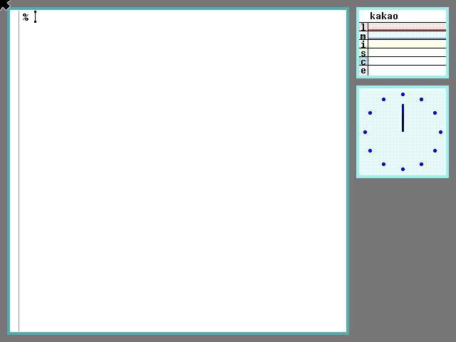

# Kakao Plan 9

Plan 9 from Bell Labs for the Kakao SOC with kakao64: the 64 bit RISC-V
port by Geoff Collyer and Richard Miller (the `9k` kernel), with a
configuration of its own for the machine the SOC is, QEMU's `virt`.

Everything for it is in this directory, and it is built here, on Linux:
no Plan 9 machine is needed.

## Status

**In QEMU the machine is a headless CPU server on a Plan 9 network**: it
authenticates users with its own authentication server, another Plan 9
machine runs commands on it with `cpu`, and so does drawterm from
Linux, **and it runs rio** on QEMU's screen. **On the simulated SOC** (the SOC's own Verilog with kakao64,
under Verilator) the same kernel does the same as far as one machine
alone can: its shell, the network, and a `cpu` login to itself, **and
rio on the SOC's framebuffer** (a build option of the SOC, `FB=1`).
**On a board**, the Sergei ML2, it boots to its shell from the SD card
and, with a bitstream built `INPUT=1 FB=1`, runs rio on the monitor
with the USB keyboard and mouse: [card/README.md](card/README.md) says
how.

| | QEMU `virt` | Kakao SOC, simulated | a board |
|---|---|---|---|
| OpenSBI enters the kernel in supervisor mode | yes | yes | yes (Sergei ML2) |
| console (16550), its interrupt through the PLIC | yes | yes | yes |
| the clock (SBI timer), its rate from the device tree | yes | yes | yes |
| the size of memory from the device tree | yes, 64 MB and up | yes (256 MB) | yes (512 MB) |
| a root file system (in the kernel, a ramfs for what is written) | yes | yes | yes |
| network (virtio-mmio version 2) | DHCP, ping, TCP, 9P | ping (all the simulation's peer answers) | the device is found; no more tried |
| CPU server and authentication server; `cpu` logs in | yes, from a second machine | yes, from itself (the simulation has one machine) | not tried |
| drawterm from Linux | yes, a command; a window not tried | | not tried |
| disk (virtio) | no driver yet | no driver yet | |
| rio: a screen, a keyboard, a mouse | yes (QEMU's ramfb and virtio input) | the screen: yes, with `FB=1` (its picture is read from the simulated video); the keyboard and the mouse: their firmware has its own test, no USB devices in this simulation | yes, with a bitstream built `INPUT=1 FB=1` |

```
Kakao Plan 9: a shell.  kknet starts the network, kkcpu a CPU server.
% kknet 10.0.0.1 255.255.255.0
kakao is 10.0.0.1, authentication server 10.0.0.1
% kkcpu kakaopass1
CPU server: cpu -h 10.0.0.1 -u glenda, from a machine in the domain kakao
```

and on a second machine:

```
% kknet -n guest -a 10.0.0.1 10.0.0.2 255.255.255.0
guest is 10.0.0.2, authentication server 10.0.0.1
% kkkey kakaopass1
% cpu -h 10.0.0.1 -c 'cat /dev/sysname; echo; cat /mnt/term/dev/sysname; echo'
kakao
guest
```



rio as the simulated SOC's video shows it (640 by 480, 8 bits a pixel,
the framebuffer in main memory).

[docs/port.md](docs/port.md) has the port: what the machine is to Plan 9,
what was changed, and what is left. [docs/build.md](docs/build.md) has how
Plan 9 is built on Linux here.

## Building and running

```
make            # fetch the sources, build the tools, the libraries,
                # the commands and the kernel: build/9kkcpu.bin
make test       # boot it in QEMU and check the answers: the shell; two
                # machines, one the CPU server of the other; rio; the
                # network and a 9P mount; the SOC's device tree
make qemu       # boot it in QEMU on this terminal, with a network device;
                # Ctrl-A x leaves
make qemu-rio   # the same in a window, with a keyboard and a mouse:
                # kkrio at the console starts the window system
make drawtermtest DRAWTERM=...
                # drawterm on this machine logs in to it (as root)
make simtest SIM=... OPENSBI=...
                # the same kernel on the simulated SOC: most of an hour,
                # and docs/port.md says what it needs
```

The first `make` takes about a quarter of an hour, most of it plan9port
building; after a change under `overlay/`, `make kernel` takes seconds.

What the host needs (Debian and Ubuntu package names):

- `build-essential`, `gcc-multilib` (the compilers are built as 32 bit
  programs), `git`, `patch`
- `qemu-system-misc` for `make qemu` and `make test` (QEMU 8.2 was used),
  and `python3` for the rio test
- `device-tree-compiler` for the last part of `make test`, which is left
  out without it
- network access to github.com, for `make fetch`: plan9port and the Plan 9
  Foundation's Fourth Edition tree, at the commits in
  [upstream/versions.mk](upstream/versions.mk). The 9k distribution itself
  is in `upstream/`, as it was fetched.
- one of: running as root, `bwrap` (bubblewrap), or unprivileged user
  name spaces (`unshare -r`): the build runs with `build/root` as its
  root directory ([docs/build.md](docs/build.md) says why). Only running
  as root has been tried.

## Layout

```
plan9/
  Makefile            fetch, tools, root, libs, cmds, kernel, qemu, test, dttest,
                      drawtermtest, simtest
  upstream/           dist.9k-rv.tgz (the 9k distribution), its checksum,
                      and the commits of what else is fetched
  overlay/            files laid over the Plan 9 sources: ours
    sys/src/9k/rv/kkcpu       the kernel's configuration for this machine
    sys/src/9k/rv/kk/defs     its addresses, and how its boot is built
    sys/src/9k/rv/kk/boot.c   the first user program
    sys/src/9k/rv/kk/kkinit   what it runs: the root into a ramfs, a shell
    sys/src/cmd/auth/passtokey.c   a password's key, for kkcpu
    sys/src/9k/rv/screen.[ch], kkscreen.c, kkpool.c, mouse.c   the screen
    sys/src/9k/rv/kkinput.c   keyboards and mice (virtio input)
    sys/src/9k/rv/ethervirtio.c   the network driver
    sys/src/9k/rv/kkfdt.[ch]  what the kernel reads from the device tree
    sys/src/9k/rv/getdefs     the distribution's, changed for this build
    sys/src/libsec/port/chacha.c   a cipher the kernel wants of libsec
  rootfs/             the root file system's own files: /lib/namespace,
                      kknet, kkkey, kkcpu, kkexport, kkrio, the services
  card/               boot.json for a board's SD card, and what to do
  patches/            changes to files of the distribution and of the
                      Fourth Edition: kakao.patch, and console.patch
                      (the serial console's Backspace and ^C)
  tools/
    mkhost.sh         builds jc, jl, ja and ar as Linux programs
    p9aout.c          size and strip for Plan 9 executables
    mkroot.sh         puts the Plan 9 source root together
    p9run             runs rc in that root
    qemutest.sh       the boot test
    nettest.sh        the network test, with a 9P server on the host
    cputest.sh        two machines: a CPU server and its user
    riotest.sh, .py   the window system, worked through QEMU's QMP
    fbtest.sh, .py    the kernel on the SOC's framebuffer, in QEMU's memory
    drawtermtest.sh   drawterm on the host logs in
    simtest.sh, .txt  the test on the simulated SOC, and what it types
  docs/               port.md, build.md
  build/              everything fetched and built (not in git)
```

## Licences

The 9k distribution and the Fourth Edition are under the MIT licence
(`upstream/dist.9k-rv.tgz` carries its `LICENSE`: Plan 9 Foundation,
2021). What is written here (the overlay but for `getdefs` and for
`screen.c` and `screen.h`, which are the Fourth Edition's Raspberry Pi
files changed; the patches, the tools, the documents) is BSD-2-Clause, as the rest of this
repository. plan9port, fetched at build time and not distributed from
here, has its own licence in its tree.
